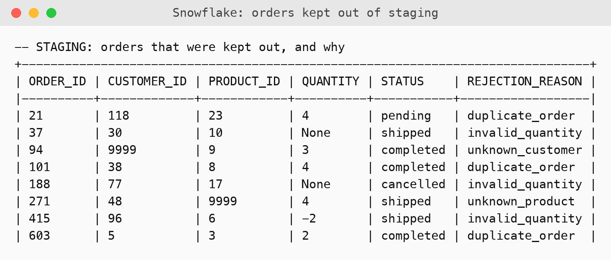
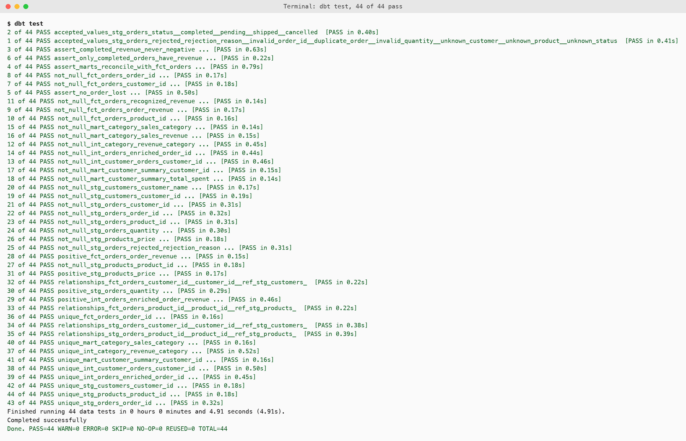
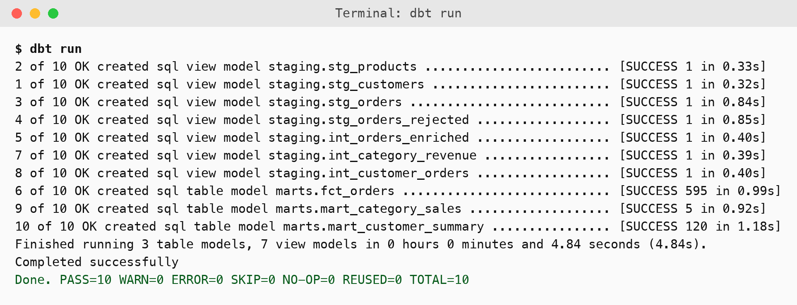
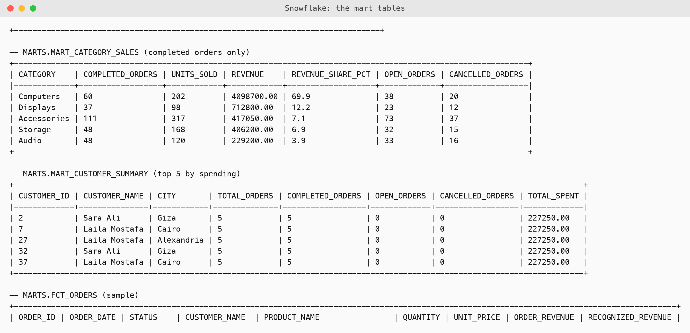
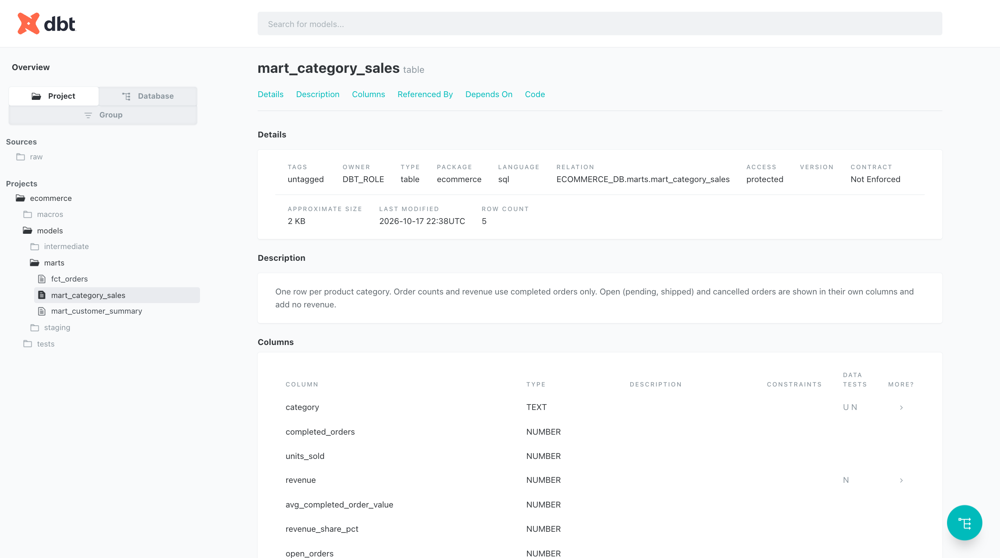
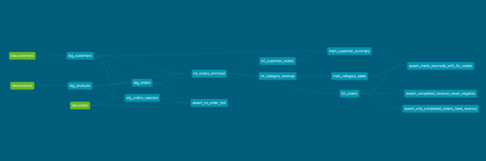
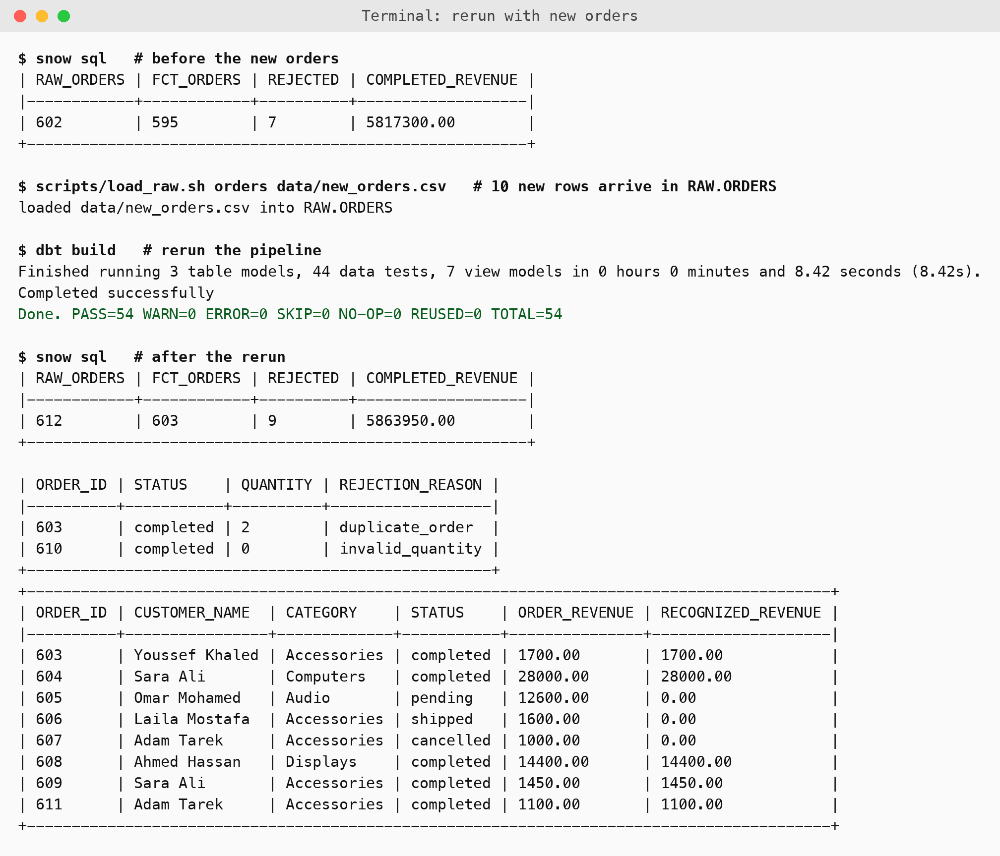

# E-commerce ELT on Snowflake with dbt

Three CSV files (customers, products, orders) are loaded into Snowflake, then dbt cleans them, joins them, builds reporting tables and tests all of it. The data deliberately contains bad rows, and the pipeline finds every one of them and says why it was kept out.

```
CSV files  ->  Snowflake ECOMMERCE_DB.RAW  ->  dbt staging  ->  dbt intermediate  ->  ECOMMERCE_DB.MARTS
(3 files)      text, exactly as in the file     STAGING schema    STAGING schema        fct_orders
                                                                                        mart_customer_summary
                                                                                        mart_category_sales
```

## The tasks

| Task | Where it is done |
|---|---|
| 1. Set up Snowflake | `sql/01_snowflake_setup.sql` creates `ECOMMERCE_DB` with `RAW`, `STAGING` and `MARTS`, plus a dbt role and service user. `sql/02_create_raw.sql` and `scripts/load_raw.sh` create the RAW tables and load the three CSVs. |
| 2. Staging models | `stg_customers`, `stg_products`, `stg_orders` in `dbt/models/staging` (and `stg_orders_rejected`) |
| 3. Transformation models | `int_orders_enriched`, `int_customer_orders`, `int_category_revenue` in `dbt/models/intermediate` |
| 4. Analytics marts | `fct_orders`, `mart_customer_summary`, `mart_category_sales` in `dbt/models/marts` |
| 5. Data quality tests | 44 tests: generic tests in the `.yml` files and 4 custom SQL tests in `dbt/tests` |
| 6. Run and document | `dbt run`, `dbt test`, `dbt docs generate`, the lineage graph, and the rerun below |

## What was wrong with the data, and what the pipeline does

The files were profiled before writing any model. Each problem below is handled in `dbt/macros/orders_checked.sql` (orders) or in the staging models.

| Problem in the files | Rows | How it is handled |
|---|---|---|
| Exact duplicate orders (21 and 101) | 2 | The first copy is kept, the other goes to `stg_orders_rejected` as `duplicate_order` |
| Blank quantity (orders 37 and 188) | 2 | Rejected as `invalid_quantity` |
| Negative quantity (order 415, quantity -2) | 1 | Rejected as `invalid_quantity` |
| Order for a customer that does not exist (order 94) | 1 | Rejected as `unknown_customer` |
| Order for a product that does not exist (order 271) | 1 | Rejected as `unknown_product` |
| Blank city (21 customers) | 21 | Kept, city set to `Unknown` |
| Blank email (customer 9) | 1 | Kept, email stays null |

Nothing disappears silently: the 602 raw order rows are 595 in `stg_orders` plus 7 in `stg_orders_rejected`, and a test checks that this always adds up.



## Revenue rules

- `order_revenue` = quantity x product price, calculated for every valid order, whatever its status.
- `recognized_revenue` is that same amount for **completed** orders only, and 0 for every other status.
- **Pending and shipped orders** are not revenue yet. They are counted as `open_orders`.
- **Cancelled orders** are never revenue. They are counted as `cancelled_orders`.
- `mart_customer_summary.total_spent` and `mart_category_sales.revenue` both use completed orders only, and a test proves they add up to the same total as `fct_orders`.

## Tests

| Kind | What it checks |
|---|---|
| Unique and not null | `customer_id`, `product_id` and `order_id` in the staging models, and the keys of the intermediate and mart models |
| References | every order points to a real customer and a real product (`relationships`) |
| Positive values | product prices, order quantities and order revenue (a custom `positive` test in `dbt/macros/test_positive.sql`) |
| Accepted values | order status is one of completed, pending, shipped, cancelled |
| Custom business rules | completed revenue is never negative, only completed orders have revenue, the marts add up to `fct_orders`, no order row is lost |



## Results

`dbt run` builds 10 models (7 views and 3 tables) and `dbt test` passes 44 of 44.



The mart tables, calculated from completed orders:



The revenue was also recalculated independently from the CSV files in Python and matches Snowflake exactly: 5,817,300.00 for the first load, and the same figure for every category.

### Documentation and lineage

`dbt docs generate` produces the documentation. Every model and the revenue rules are described there.



The lineage graph shows the dependencies from the raw tables to the marts:



## Rerunning when new orders arrive

New orders are added to `RAW.ORDERS` by loading another file with `COPY INTO`, which appends rows. Because every dbt model is built from RAW, the same two steps bring everything up to date:

```bash
scripts/load_raw.sh orders data/new_orders.csv     # 1. append the new rows to RAW.ORDERS
cd dbt && ../.venv/bin/dbt build                   # 2. rebuild the models and rerun every test
```

This was tried with `data/new_orders.csv`: 10 rows, of which 8 are valid, 1 is a duplicate of order 603 and 1 has quantity 0. Completed revenue went from 5,817,300.00 to 5,863,950.00, which is exactly the 46,650.00 expected from the file. The 2 bad rows landed in `stg_orders_rejected`, and all 54 steps still passed.



On a bigger dataset the same flow could run on a schedule, and `fct_orders` could be made an incremental model so only new orders are processed. With 600 orders a full rebuild takes a few seconds, so tables are used for simplicity.

## Run it

Needs Python 3, the Snowflake CLI (`snow`), `openssl` and a Snowflake account where you can run the setup SQL.

```bash
python3 -m venv .venv
# macOS python.org Python only: export SSL_CERT_FILE=$(python3 -c "import certifi;print(certifi.where())")
.venv/bin/pip install -r requirements.txt

scripts/new_keypair.sh                 # makes the key pair and prints the public key
# paste the public key into sql/01_snowflake_setup.sql and run it in Snowsight with Run All
snow connection add --connection-name ecommerce ...   # DBT_USER, key pair, role DBT_ROLE, warehouse ECOMMERCE_WH
scripts/load_raw.sh                    # RAW tables and the three CSVs

cd dbt
export DBT_PROFILES_DIR=$PWD
../.venv/bin/dbt run && ../.venv/bin/dbt test
../.venv/bin/dbt docs generate && ../.venv/bin/dbt docs serve
```

The private key stays in `~/.ecommerce_keys` and is never committed. Set `ECOMMERCE_PRIVATE_KEY_PATH` to read it from somewhere else, and `SNOWFLAKE_ACCOUNT` for another account.

## Problems found along the way

- **Run All.** The setup script switches roles several times, so in Snowsight it has to be run with Run All, not with a single Run.
- **PUT with spaces in the path.** The file path in the `PUT` command has to be quoted, because the folder name has spaces.
- **Deprecated properties.** dbt 1.12 wants `freshness` and `loaded_at_field` inside the source's `config`, which was changed.

## Limits

- The raw tables hold text, so a value that cannot be converted becomes null in staging instead of failing the load. This is deliberate and the rejected-rows table makes it visible.
- Customer names repeat across different customer ids in the sample data (for example several customers are called Sara Ali). Ids are unique, so nothing is merged.
- The data is small (120 customers, 25 products, about 600 orders), so this shows the design and not performance at scale.
- The lineage graph also shows the custom tests as small nodes.

## Layout

```
data/        the three CSV files, and new_orders.csv for the rerun
sql/         Snowflake setup and the RAW tables
scripts/     key pair, and the CSV loader
dbt/         models (staging, intermediate, marts), macros, tests, profiles
evidence/    raw logs of the runs
screenshots/ images used above
```
